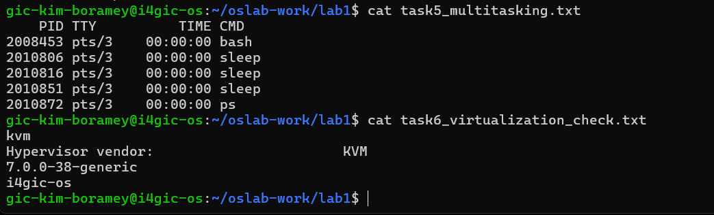

# Operating Systems Lab 1
## Introduction to Operating Systems

**Student:** Kim Boramey  
**Student ID:** e20231250  
**Operating System:** Ubuntu 26.04.1 LTS (WSL)  
**Lab:** Lab 1 – Introduction to Operating Systems

---

## Task 1: Operating System Information

**Commands used:**
```bash
uname -a > task1_os_info.txt
lsb_release -a >> task1_os_info.txt
cat task1_os_info.txt
```

**Results:**
- Kernel: Linux
- Distribution: Ubuntu 26.04.1 LTS
- Kernel version: 7.0.0-38-generic

The commands displayed and saved information about the operating system.

## Task 2: Files and Directories

**Files created:**
- `task2_files/pencil.txt`
- `task2_files/tiger_renamed.txt`

**File contents:**
- pencil.txt: `This is file pencil`
- tiger_renamed.txt: `This is file tiger`

The files were created and organized inside the `task2_files` directory. The second file was renamed to `tiger_renamed.txt`.

## Task 3: APT Package Management

**Package:** Midnight Commander (`mc`)

The following operations were performed:

1. Updated the package list using `sudo apt-get update`.
2. Installed `mc` using `sudo apt-get install mc -y`.
3. Checked its executable path using `which mc`.
4. Removed the package using `sudo apt-get remove mc -y`.
5. Purged the package using `sudo apt-get purge mc -y`.

**Results:**

- After installation: `/usr/bin/mc` was found.
- After removal: `/etc/mc` still existed.
- After purging: `/etc/mc` no longer existed.

The results were recorded in `task3_apt.txt`.

## Task 4: Process Management

**Commands used:**
```bash
which sleep
sleep 30 &
ps > task4_process_list.txt
cat task4_process_list.txt
```

**Result:**

A sleep process was started in the background. The `ps` command displayed the running processes and saved the output.

## Task 5: Multitasking

**Commands used:**
```bash
sleep 300 &
sleep 300 &
sleep 300 &
ps > task5_multitasking.txt
```

**Result:**

Three sleep processes were started in the background. The process list confirmed that all three were running simultaneously.

## Task 6: Virtualization

**Commands used:**
```bash
systemd-detect-virt > task6_virtualization_check.txt
lscpu | grep -i "hypervisor vendor" >> task6_virtualization_check.txt
uname -r >> task6_virtualization_check.txt
hostname >> task6_virtualization_check.txt
```

**Results:**
- Virtualization detected: KVM
- Hypervisor vendor: KVM
- Kernel release: 7.0.0-38-generic
- Hostname: i4gic-os

## Conclusion

In this lab, I practiced basic Linux commands, file and directory management, APT package management, process management, multitasking, and virtualization detection.

I also learned how to save command outputs into text files for documentation and verification.

**Verification:** The university lab checker reported 4/4 core milestones passed.
## Screenshot Evidence

### Task 5 and Task 6


